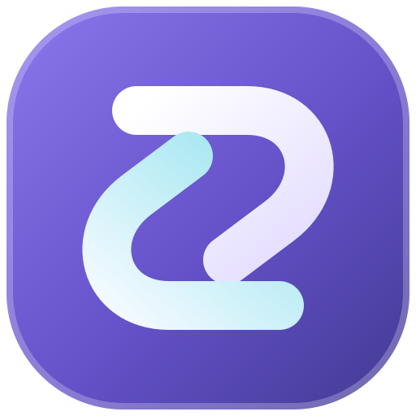

<p align="center"></p>
<h1 align="center">Interlude</h1>
<p align="center">少一点重复操作，多一点专注。<br />一个精简的 Codex 账号管理工具。</p>
<p align="center"><a href="README_EN.md">English</a> · <b>简体中文</b> · <a href="https://github.com/elorinlabs/Interlude/releases/latest">下载安装</a> · <a href="https://github.com/elorinlabs/Interlude/issues/new">问题反馈</a></p>
<p align="center">  </p>

Interlude 帮你集中管理 Codex 账号、查看额度、切换账号和备份登录信息。它启动并配合已安装的官方 Codex，围绕账号操作减少重复步骤。

**当前发布：Windows x64。作者：JingXing。** 应用提供中文和英文等语言选择；本页与 [English guide](README_EN.md) 分别提供完整使用说明。

## 能做什么

| 功能 | 说明 |
| --- | --- |
| 添加与合并 | 浏览器授权、无痕登录、已有凭据文件导入；重复账号合并 |
| 切换与启动 | 手动切换账号、启动官方 Codex，继续使用同一本地对话目录 |
| 账号健康 | 单个或批量检查、修复入口、保存登录信息后的授权恢复与进度提示 |
| 额度可视化 | 五小时与周剩余额度、服务方返回的恢复时间、当前账号后台更新 |
| 桌面小组件 | 独立显示当前账号的五小时和周额度，可在首页开关 |
| Token 历史 | 汇总本机可读取的历史用量，按时间与账号查看明细 |
| 可选自动化 | 按额度恢复时间安排问候、现有目标接力；需主动配置开启 |
| 完整备份 | 单个加密文件备份／恢复账号、已保存的密码、验证器密钥和自动登录信息 |
| 目录备份 | 本地、移动硬盘或网盘客户端同步目录，不需要旧同步服务器 |

Token 统计以本机可读取的记录为准，不能补全服务方未提供的其他设备或账号终身用量。自动登录遇到服务方人工验证时仍需本人完成。反重力实现源码保留，当前入口关闭。

## 安装与开始使用

1. 前往 [Releases](https://github.com/elorinlabs/Interlude/releases/latest)，下载 `Interlude_*_x64-setup.exe`。
2. 可将下载文件的 SHA-256 与发布页 `SHA256SUMS.txt` 核对。当前安装包未做代码签名；Windows 可能提示未知发布者，请确认来源后自行决定安装。
3. 安装并打开 Interlude。请先安装官方 Codex，再通过浏览器授权或导入已有凭据添加账号。
4. 查看账号状态，按需切换或启动 Codex。已有账号数据应先做一次完整备份。

Interlude 使用独立应用标识，可与原工具共存；实际系统兼容性以发布说明和你的测试为准。安装完成不会自动导入其他工具的全部数据。

## 备份最省事的做法

打开 **备份与恢复 → 离线完整备份**，设置至少 12 位的备份密码，保存一个 `.interlude-backup` 文件。换电脑或重装后，用原文件和原密码合并恢复。

- 包含已保存的账号凭据、密码、验证器原始密钥和自动登录配置；没有保存过的信息无法补出。
- 文件放在不会随系统重装丢失的地方，密码单独保管；丢失密码无法重置。
- 想自动备份，可选网盘客户端的本地同步目录。预设包括坚果云、百度网盘、阿里云盘、夸克、微云、123 云盘和 OneDrive；上传由网盘客户端负责，不是这些网盘的直接 API 接入。
- 旧 `.cs` 文件只保留导入兼容，新备份使用完整加密格式。

详细说明：[完整离线备份](docs/offline-backup.md) · [目录与网盘备份](docs/local-cloud-sync.md)。

## 常见问题

**切换后对话还在吗？** 账号切换沿用本地 Codex 对话目录，不会把服务方账号数据迁移到另一个账号，也不能保证所有账号都能访问同一云端资源。切换会中断官方应用中正在运行的任务，请留意界面状态。

**为什么恢复后还需要验证？** 备份恢复已保存的数据；服务方可以让令牌失效或要求人工验证，无法保证永久登录。

**所有功能都需要服务器吗？** 当前账号管理与备份不需要原来的账号同步服务器。登录、额度查询、Codex 请求以及你选择的网盘同步仍依赖各自服务。

**安全吗？** 自动登录信息由系统凭据库保存，完整备份加密包含密码和 TOTP。请保护 Windows 账号、备份密码和恢复密钥。公开反馈前务必脱敏。见 [安全说明](SECURITY.md)。

## 从源码运行

需要 Node.js 22+、npm、Rust stable，以及 Windows Tauri 开发环境（MSVC C++ 工具链和 WebView2）。

```powershell
git clone https://github.com/elorinlabs/Interlude.git
cd Interlude
npm ci
npm run dev:app
```

仅前端预览使用 `npm run dev`，不具备本机凭据和进程权限。

```powershell
npm run build
npm run check:i18n
node scripts/build-desktop-app.mjs --bundles nsis
```

默认 build/test/check 面向当前桌面工具。仓库仍保留其他工作区及其共享代码以维持依赖关系；它们不代表当前安装包开放了内置聊天、代理或远程桌面功能。可选 VC-LTL / YY-Thunks 构建工具不随源码分发。

## 文档与参与

[安全说明](SECURITY.md)

当前清理版本的桌面 1,287 项测试、18 项原生备份测试及编译检查通过；这不等于对所有真实账号、所有 Codex 版本和跨电脑恢复完成验收。已有编译警告仍在。

## 来源与许可

基于 [piperhex/remoteai](https://github.com/piperhex/remoteai) 精简修改，按 [Apache-2.0](LICENSE) 分发，归属说明见 [NOTICE](NOTICE)。保留上游及第三方许可证。目标仓库初始 MIT 文件另存为 [历史许可证](docs/licenses/repository-initial-MIT.txt)。

Interlude 是独立社区工具，与 OpenAI 无隶属关系，也不是官方 Codex 产品。相关商标归各自所有者所有。
