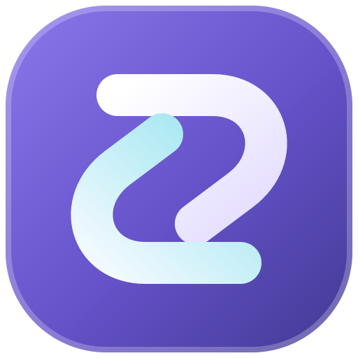
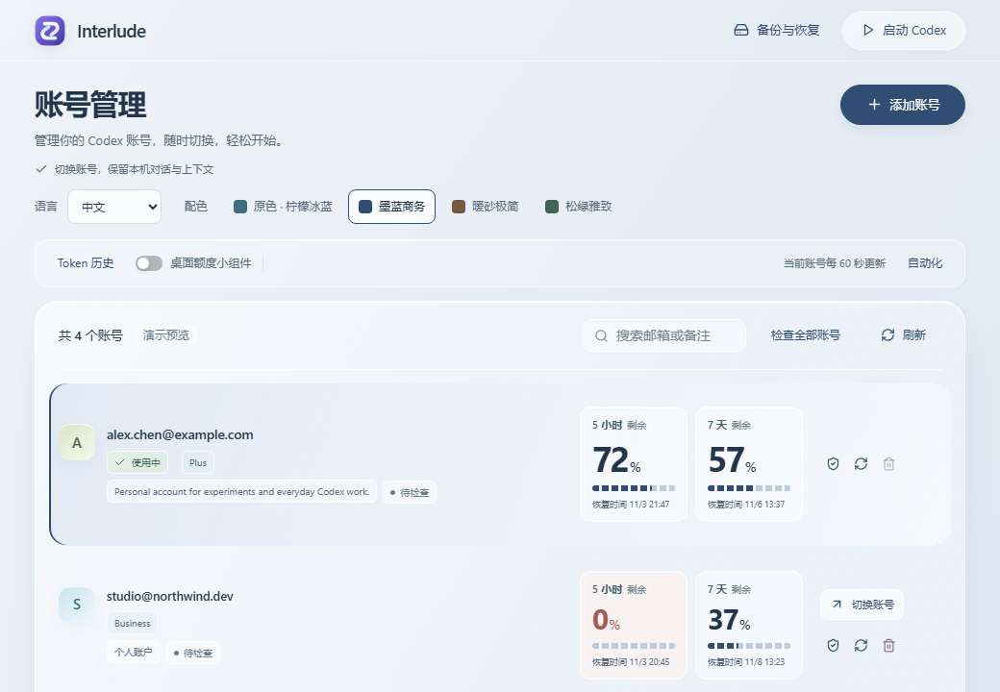
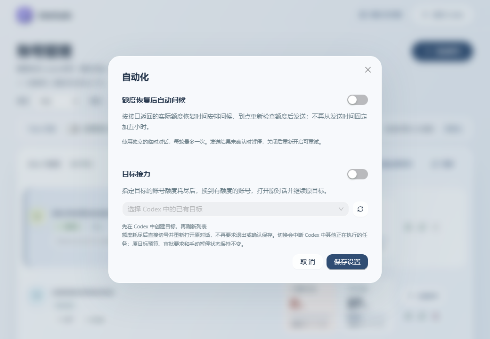

<p align="center"></p>
<h1 align="center">Interlude</h1>
<p align="center">A handy place for your Codex accounts.</p>
<p align="center"><a href="README.md">简体中文</a> · English · <a href="https://github.com/elorinlabs/Interlude/releases/latest">Download</a></p>

Signing in, checking quotas and finding backups gets repetitive when you use more than one account. Interlude brings those everyday tasks into one window.



## What it does

- Add accounts through a browser, a private window or an existing credential file; duplicate accounts are merged.
- Switch accounts and launch Codex while keeping your local conversation directory.
- See five-hour and weekly quotas, reset times and account health; show a quota widget on your desktop.
- Inspect locally available token history and check accounts in a batch.
- Save login details to help recover authorization, with progress shown along the way.
- Back up accounts, saved passwords and authenticator secrets in an encrypted offline file or a local sync folder.
- Switch between Chinese and English and choose one of four palettes.

## Automation



Optionally schedule a greeting when quota recovers or configure goal relay. Relay switches accounts and reopens the conversation; switching may interrupt other work running in Codex. Both features require configuration.

## Install

Download the Windows x64 installer from [Releases](https://github.com/elorinlabs/Interlude/releases/latest). Back up existing account data first and install official Codex separately. The installer is currently unsigned; check its hash using `SHA256SUMS.txt` on the release page.

## Backup and recovery

Open Backup & restore, choose an offline complete backup, set a passphrase of at least 12 characters and save the file. Restore with the same file and passphrase after reinstalling or moving computers. Keep the file somewhere that will survive a reinstall and store the passphrase separately. Information never saved cannot be recovered from a temporary code.

[Offline backups](docs/offline-backup.md) · [Directory backups](docs/local-cloud-sync.md) · [Security](SECURITY.md)

Providers may require you to sign in again or complete a human challenge. Token history reflects locally readable data, not a complete cross-device account history.

## Develop

Requires Node.js, Rust, Windows MSVC tools and WebView2.

```powershell
git clone https://github.com/elorinlabs/Interlude.git
cd Interlude
npm ci
npm run dev:app
```

Build an installer with `node scripts/build-desktop-app.mjs --bundles nsis`.

Author: JingXing · [Apache-2.0](LICENSE) · [License notices](NOTICE)

Interlude is an independent community tool, not an official OpenAI product. Screenshots show demonstration data.
